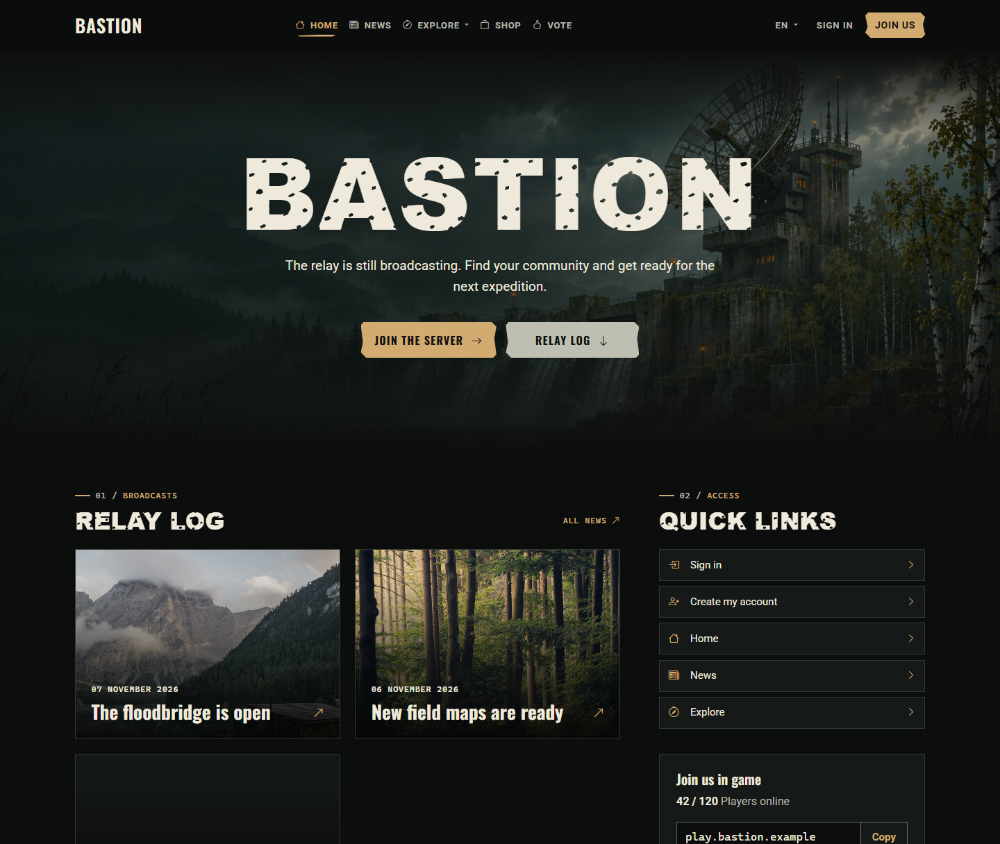

# Bastion for KraftInk

Bastion gives your KraftInk site the look of a radio outpost after the collapse. The homepage pairs an illustration of a flooded relay with your server journal and quick access to your community.

## Set up Bastion

1. In KraftInk, open **Administration → Themes** and install Bastion from the catalogue or upload its ready-to-install ZIP.
2. Click **Use for website**.
3. Set your homepage heading and public server address in KraftInk. Publish news to populate the server journal.

[KraftInk](https://kraftink.com/en) · [Theme installation guide](https://kraftink.com/en/documentation/extensions-catalogue) · [Discord](https://discord.kraftink.com)
